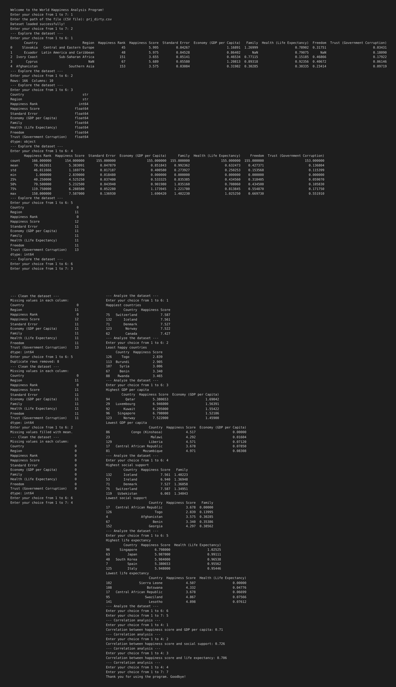

# World Happiness Analysis Program

## Project Description

The World Happiness Analysis Program is a menu-driven Python application that analyzes the World Happiness dataset. It lets the user load a CSV file, explore its contents, clean the data, find the happiest and least happy countries, measure how happiness relates to factors such as GDP per capita, social support and life expectancy, and view the results as charts.

## Features

| No. | Feature | Description |
|-----|---------|-------------|
| 1 | Load the dataset | Reads a CSV file from the path entered by the user |
| 2 | Explore the dataset | Shows first rows, shape, data types, summary statistics and missing values |
| 3 | Clean the dataset | Handles missing values (drop, mean, median, mode) and removes duplicates |
| 4 | Analyze the dataset | Finds the happiest and least happy countries, and the highest and lowest GDP, social support and life expectancy |
| 5 | Correlation analysis | Finds the correlation of happiness score with GDP per capita, social support and life expectancy |
| 6 | Visualize the dataset | Bar charts, scatter plots and a correlation heatmap |
| 7 | Exit | Closes the program |

## Technologies Used

- **Git** – version control
- **GitHub** – hosting the project repository
- **VS Code** – code editor
- **Python** – programming language
- **Pandas** – data handling and analysis
- **Matplotlib** – plotting charts
- **Seaborn** – bar charts and heatmap

## Concepts Used

| Concept | Where it is used |
|---------|------------------|
| Loops (`while`) | Main menu and sub-menus |
| Conditional statements (`if / elif / else`) | Menu choices |
| Exception handling (`try / except`) | Loading the CSV file |
| Data cleaning | Missing values and duplicates |
| Sorting and selecting data | Happiest and least happy countries |
| Correlation | Happiness score vs other factors |
| Data visualization | Bar charts, scatter plots, heatmap |

## How to Run / Installation

1. Install Python 3 from [python.org](https://www.python.org/downloads/).
2. Clone the repository:
   ```
   git clone <your-repository-link>
   cd <repository-folder>
   ```
3. Install the required libraries:
   ```
   pip install pandas matplotlib seaborn
   ```
4. Run the program:
   ```
   python world_happiness_simple.py
   ```
5. Choose option **1** first and enter the path of the CSV file (for example `prj.csv`).

## Project Structure

```
├── happiness.csv   
├── main.ipynb                   
├── output.png
├── README.md
├── Visualization.png            
```

## Output / Screenshots

**Main menu**




## Conclusion

This project shows how Python and Pandas can be used to load, clean, analyze and visualize a real-world dataset through a simple menu-driven program. The analysis shows that GDP per capita, social support and life expectancy are all positively related to a country's happiness score, and the charts make these patterns easy to see.

## Author

**[Your Name]**